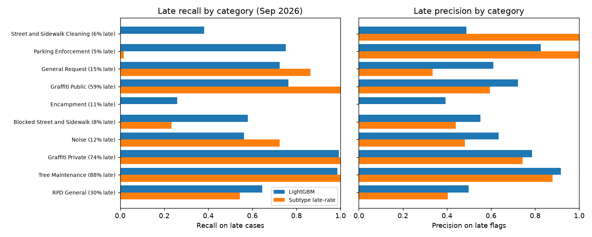

# SF 311 Triage

Route San Francisco 311 requests from the citizen's photo, and predict how long each one will take to resolve, trained on a year of real city data (867k requests, ~30k photos).



## Why

San Francisco gets ~70,000 311 requests a month: overflowing trash, graffiti, blocked sidewalks, abandoned cars, fallen trees. Each must be sorted into the right category and sent to the right agency, and residents get no idea when it will be fixed.

YC's [Requests for Startups](https://www.ycombinator.com/rfs) (Winter 2027) ask for **AI for City Hall** (municipal work is still largely manual) and **Own Your Intelligence** (small models you own instead of renting frontier ones). This project tests both on real data:

1. **Photo routing:** can a model read the photo and pick the right category? How does a free zero-shot model compare with a small model you train yourself?
2. **Resolution time:** can we predict how long a request will take, and flag the ones that will be late, *per category*? Earlier public attempts look good on overall accuracy but miss every late case in some categories (see [prior work](docs/prior_work.md)).

## Results

All numbers are on held-out months the models never saw: forward time split, train Nov 2025 – Jul 2026, validate Aug, test Sep 2026 (+ Oct for drift).

### 1. Photo routing (13 classes, 6,500 test photos, 500 per class)

| Approach | Accuracy | Macro-F1 | Est. accuracy on real traffic mix | CPU ms / photo | Size | Cost / 1,000 photos |
|---|---:|---:|---:|---:|---:|---:|
| Always guess the biggest class | n/a | n/a | 0.437 | n/a | n/a | $0 |
| CLIP ViT-B-32 zero-shot (prompts only) | 0.472 | 0.444 | 0.492 | ~34 | 351 MB | ~$0 |
| **Fine-tuned MobileNetV3-Small** (served in the app) | 0.568 | 0.565 | 0.543 | **~6** | **6.3 MB** | ~$0 |
| **CLIP embeddings + logistic regression** | **0.636** | **0.631** | **0.613** | ~42 | 351 MB | ~$0 |
| Frontier vision LLM (Claude Haiku / Sonnet) | not run yet | | | API | API | est. ~$0.15 / ~$3 |

Random guessing is 0.077. Details: [CLIP zero-shot](reports/clip_zeroshot.md) · [fine-tuned vs probe](reports/finetune.md) · [vision LLM harness](reports/vision_llm.md) (built and unit-tested; needs an API key to run).

**Takeaways**
- A few thousand labelled photos beat prompt engineering: both trained models clearly beat zero-shot CLIP.
- The CLIP linear probe is the most accurate; MobileNet is 55× smaller and ~7× faster for ~7 points less macro-F1, so the app serves MobileNet.
- Distinct things are easy: parking (0.87 recall), blocked sidewalks (0.81), private graffiti (0.80). The hard classes are the ones defined by *policy, not appearance*: "General Request" (0.27), "Other", and street cleaning vs. litter-bin issues. Better routing there needs text or location, not a better image model.

### 2. Resolution time (Sep 2026 test, 66,469 requests)

"Late" = not closed within 7 days (15.6% of requests).

| | Per-subtype baseline | LightGBM | LightGBM without agency (conservative) |
|---|---:|---:|---:|
| Late: ROC-AUC | 0.847 | **0.944** | 0.919 |
| Late: PR-AUC | 0.577 | **0.776** | 0.709 |
| Late: precision / recall / F1 | 0.57 / 0.66 / 0.61 | **0.68 / 0.72 / 0.70** | 0.63 / 0.67 / 0.65 |
| Hours: median absolute error | 8.9 h | **5.2 h** | n/a |
| Hours: R² (30-day cap) | 0.26 | **0.49** | n/a |
| Log-hours: R² | 0.36 | **0.68** | n/a |

- The only prior SF resolution model found reports R² ≈ 0.26 (2020 data); here the simple baseline already matches it and LightGBM nearly doubles it.
- **Per category:** the baseline catches 0 of 305 late Encampment cases (the same failure as a public NYC model). LightGBM has non-zero late recall in all 22 categories with ≥30 late cases; Encampment (0.26) is still the weakest.
- October 2026 drift check: ROC-AUC 0.925 vs. 0.821 for the baseline.
- Top drivers (SHAP): agency, subtype, the agency's open backlog at filing time, hour of day.

Full write-up with figures and limitations: [reports/resolution.md](reports/resolution.md).

## Try it

```bash
py -3.12 -m venv .venv
.venv\Scripts\activate
pip install -e ".[ml,clip,demo,dev]"
```

On Windows set `PYTHONPATH=src;.` (Linux/macOS: `src:.`), then:

```bash
# API: POST /route (photo + lat/lon), POST /resolution (JSON), GET /health
python -m uvicorn app.api:app --port 8000

# Demo page: upload a photo, pick a spot on the map, get category, agency and expected time to close
python -m streamlit run app/demo.py

# Tests and lint
python -m pytest
ruff check .
```

Docker: `docker build -t sf311-triage .` then `docker run -p 8000:8000 -v "$PWD/models:/app/models:ro" sf311-triage`.

The app loads the trained models from `models/` (included in the repo: MobileNet 6.5 MB, LightGBM ~20 MB). If they're missing it falls back to clearly-labelled stubs, so it always starts.

## Reproduce from scratch

```bash
python -m sf311.fetch --start 2025-11 --end 2026-10   # ~870k rows from DataSF, ~3 min
python -m sf311.resolution train                      # resolution models + report
python -m sf311.resolution_serving                    # backlog context the API uses
python -m sf311.images download                       # ~30k photos, 256 px, ~50 min
python -m sf311.clip_zeroshot embed                   # CLIP embeddings (CPU)
python -m sf311.clip_zeroshot eval
python -m sf311.train_image finetune                  # ~22 min on CPU
python -m sf311.train_image probe
python -m sf311.export_image                          # TorchScript for the app
```

Exploration: [notebooks/01_explore.ipynb](notebooks/01_explore.ipynb). Everything here ran on a laptop CPU, no GPU.

## Data

[DataSF 311 Cases](https://data.sf.gov/d/vw6y-z8j6) (PDDL licence): ~9M requests since 2008, updated nightly. This project uses Nov 2025 – Oct 2026. Notes from exploration:

- Only ~37% of requests have a usable photo (mobile app uploads on Cloudinary); web-form links are HTML pages, not images, and phone requests have none.
- Labels are long-tailed (42 categories, 264 sub-categories); the 12 biggest photo categories + "Other" cover 95%.
- ~5% of requests are still open (13% of the latest month), so recent months look artificially fast. Targets are built so labels are settled before evaluation (see the resolution report).
- ~13% of closures are administrative ("duplicate", "invalid", "transferred") and are excluded from time targets.

## Privacy

Citizen photos can show people and licence plates. The repo contains **no photos and no photo URLs**: images were cached locally only (in git-ignored `data/`) for training, and no report or figure shows one. Street addresses were never downloaded. The API decodes uploaded photos in memory and never stores them.

## Limitations

- One year of data, one city. Labels are the city's own categories, which are partly administrative.
- Agency is the strongest resolution feature but may be reassigned after filing; treat the "without agency" column as the honest estimate until that's confirmed.
- At serving time the API uses typical recent backlog values per category rather than live counts.
- Photos are 256 px thumbnails, which limits fine detail (cracks, small graffiti) for every model equally.
- The vision-LLM comparison hasn't been run (it costs money); the harness, prompt and cost estimates are ready.

## Layout

```
src/sf311/    data pull, cleaning, models (resolution, images, CLIP, fine-tuning, LLM harness)
app/          FastAPI + Streamlit demo + predictor loading
models/       trained artifacts used by the app
reports/      write-ups and figures
docs/         prior-work review
notebooks/    exploration
tests/        API + LLM-harness tests (run in CI)
```
