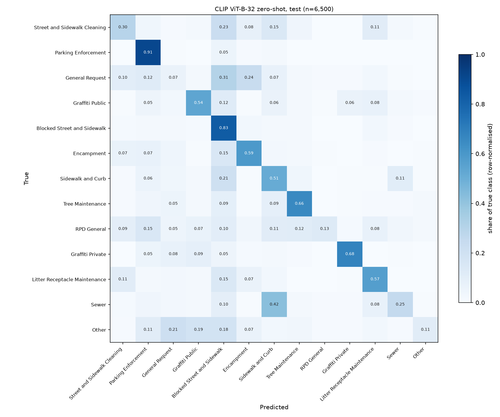
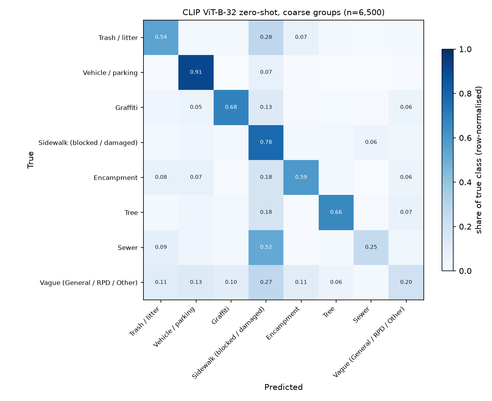

# CLIP zero-shot photo routing

Model: open_clip `ViT-B-32` (`laion2b_s34b_b79k` weights), CPU only, no training. Each of the 13 classes (12 `dataset.LABELS` + `Other`) gets 4-5 hand-written prompts describing what such a photo shows; prompt embeddings are averaged per class and each photo is assigned to the most similar class. Prompts are in `src/sf311/clip_zeroshot.py`. They were written before looking at results; one round of tweaks checked on **val** (more specific 'Blocked' prompts, extra 'Cleaning' prompts) lowered val accuracy from 0.469 to 0.448, so the originals were kept. Test was not used for any choice.

## Data

Label-balanced, fixed-seed sample of the time-based splits from `sf311.dataset` (cap per label: train 1,500, val 300, test 500; all rows when a label has fewer). Photos downloaded as 256px thumbnails via Cloudinary resizing (`python -m sf311.images download`).

| split | selected | downloaded OK |
|---|---:|---:|
| train | 19,500 | 19,500 (100.0%) |
| val | 3,833 | 3,833 (100.0%) |
| test | 6,500 | 6,500 (100.0%) |

Zero-shot is evaluated on the **test** sample only (n = 6,500, Sept-Oct 2026). Because the sample is balanced, plain accuracy is close to macro recall. The real test month mix is dominated by Street and Sidewalk Cleaning (44%) and Parking Enforcement (24%), so the table also gives a re-weighted estimate (per-class recall x real class share).

## Results

| view | accuracy (balanced test) | macro-F1 | est. accuracy on real mix |
|---|---:|---:|---:|
| 13 classes | 0.472 | 0.444 | 0.492 |
| 8 coarse groups | 0.541 | 0.542 | 0.621 |

Reference points: random guessing on the balanced sample = 0.077; always predicting the majority class on the real mix = 0.437.

### Per-class recall (13 classes)

| class | test n | recall | share of predictions | real share |
|---|---:|---:|---:|---:|
| Parking Enforcement | 500 | 0.91 | 13.0% | 23.9% |
| Blocked Street and Sidewalk | 500 | 0.83 | 19.8% | 5.8% |
| Graffiti Private | 500 | 0.68 | 6.1% | 1.3% |
| Tree Maintenance | 500 | 0.66 | 7.6% | 1.6% |
| Encampment | 500 | 0.59 | 8.8% | 3.9% |
| Litter Receptacle Maintenance | 500 | 0.57 | 7.9% | 1.4% |
| Graffiti Public | 500 | 0.54 | 7.8% | 4.3% |
| Sidewalk and Curb | 500 | 0.51 | 12.0% | 2.3% |
| Street and Sidewalk Cleaning | 500 | 0.30 | 5.7% | 43.7% |
| Sewer | 500 | 0.25 | 3.6% | 1.0% |
| RPD General | 500 | 0.13 | 1.3% | 1.6% |
| Other | 500 | 0.11 | 1.4% | 3.6% |
| General Request | 500 | 0.07 | 5.0% | 5.6% |

### Coarse, visually distinguishable groups

Merges classes a photo cannot reliably separate: the two graffiti classes (public vs private depends on who owns the wall), street cleaning + litter bins, blocked + damaged sidewalk, and the vague classes (General Request, RPD General, Other).

| group | recall | real share |
|---|---:|---:|
| Trash / litter | 0.54 | 45.1% |
| Vehicle / parking | 0.91 | 23.9% |
| Graffiti | 0.68 | 5.6% |
| Sidewalk (blocked / damaged) | 0.78 | 8.1% |
| Encampment | 0.59 | 3.9% |
| Tree | 0.66 | 1.6% |
| Sewer | 0.25 | 1.0% |
| Vague (General / RPD / Other) | 0.20 | 10.9% |

## Speed and cost

- Image embedding on CPU (batch 64, includes JPEG decode + preprocessing): **34 ms per image** averaged over 29,833 images val: 43.9 ms, test: 38.4 ms, train: 30.4 ms.
- Text side is computed once (6.7 s for all prompts); classification is one matrix product.
- Marginal cost is about **$0 per 1,000 requests** on hardware already owned (~34 s of laptop CPU per 1,000 photos). No API calls; photos never leave the machine.

## Takeaways

- **Zero-shot barely beats the majority baseline on real traffic** (0.492 vs 0.437). The biggest class, Street and Sidewalk Cleaning (44% of real photo requests), has recall 0.30: 23% of those photos go to Blocked Street and Sidewalk. Dumped items on a sidewalk look like an obstruction, so prompts alone cannot draw the line the city draws.
- Classes with a distinct visual subject work: Parking Enforcement 0.91, Graffiti Private 0.68, Tree Maintenance 0.66, Encampment 0.59.
- Sewer recall is 0.25; 42% go to Sidewalk and Curb (drains and manholes sit in the pavement).
- The vague classes are close to random (0.077) (General Request 0.07, RPD General 0.13, Other 0.11): the label describes the process, not the picture. General Request photos mostly go to Blocked Street and Sidewalk (31%).
- Merging look-alike classes lifts balanced accuracy from 0.472 to 0.541 and the real-mix estimate from 0.492 to 0.621, so much of the error is between neighbouring classes, not random.
- Next step: a linear probe or fine-tune on the saved embeddings / images should learn the cleaning-vs-blocked boundary that prompts miss.
- Embeddings for train/val/test are saved in `data/embeddings/` for a cheap linear probe and for comparison with the fine-tuned model.

_Privacy: this report holds aggregate numbers only; no photos or photo URLs._
