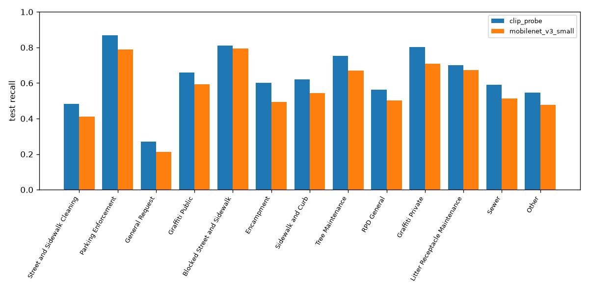
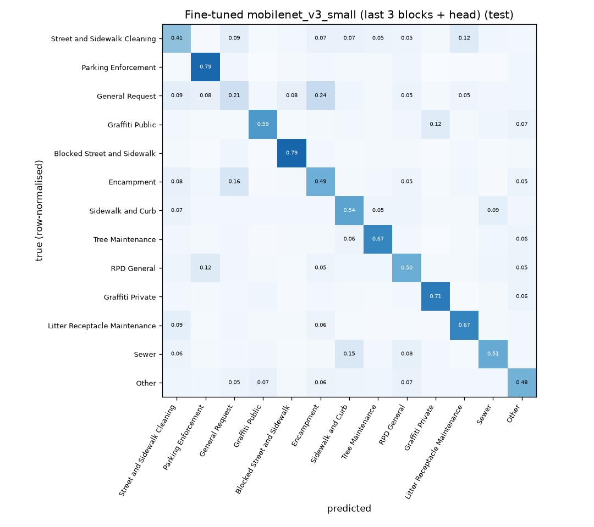

# Photo routing: fine-tuned CNN vs CLIP linear probe

Generated by `python -m sf311.train_image report`. 13 classes (12 top `service_name`s + Other); time-based split from `sf311.dataset` (train < 2026-08, val Aug 2026, test Sep 2026+). CPU only (8 logical cores). Photos are never shown or linked here.

## Comparison (test split)

| Approach | Test n | Accuracy (balanced test) | Macro-F1 | Est. accuracy on real mix | Train time | CPU ms/image (batch 1, 6 thr / 1 thr) | Model size |
|---|---:|---:|---:|---:|---|---:|---:|
| CLIP ViT-B-32 embeddings + logistic regression | 6500 | 0.636 | 0.631 | 0.613 | 12 s fit (+ CLIP embedding of train/val/test, shared job) | 41.5 / 89.7 | 351.4 MB |
| Fine-tuned mobilenet_v3_small (last 3 blocks + head) | 6500 | 0.568 | 0.565 | 0.543 | 22.2 min | 6.2 / 5.5 | 6.3 MB |
| CLIP ViT-B-32 zero-shot (see [clip_zeroshot.md](clip_zeroshot.md)) | 6500 | 0.472 | 0.444 | (in that report) | none | ~same encoder as probe | ~351 MB |
| Frontier vision LLM (see [vision_llm.md](vision_llm.md)) | | | | | none | API | API |

Latency: single random 224px image, after warm-up; first figure uses the training thread count, second one thread. Model size: weights on disk (for the probe: CLIP image encoder fp32 + the logistic-regression head). Est. accuracy on real mix = per-class test recall weighted by each class's share of all photo requests in the test window (same method as clip_zeroshot.md). Chance on the balanced test set is about 0.077.

## Takeaways

- Best macro-F1: **CLIP ViT-B-32 embeddings + logistic regression** (0.631).
- Smallest / fastest: **Fine-tuned mobilenet_v3_small (last 3 blocks + head)** (6.3 MB, 6.2 ms/image on CPU), 0.565 macro-F1.
- Both trained models beat CLIP zero-shot; the labelled training photos are worth more than prompt engineering. The catch-all classes (General Request, Other, Street and Sidewalk Cleaning) stay the weakest.

## Per-class test recall

| Class | clip_probe | mobilenet_v3_small |
|---|---|---|
| Street and Sidewalk Cleaning | 0.48 | 0.41 |
| Parking Enforcement | 0.87 | 0.79 |
| General Request | 0.27 | 0.21 |
| Graffiti Public | 0.66 | 0.59 |
| Blocked Street and Sidewalk | 0.81 | 0.79 |
| Encampment | 0.60 | 0.49 |
| Sidewalk and Curb | 0.62 | 0.54 |
| Tree Maintenance | 0.75 | 0.67 |
| RPD General | 0.56 | 0.50 |
| Graffiti Private | 0.80 | 0.71 |
| Litter Receptacle Maintenance | 0.70 | 0.67 |
| Sewer | 0.59 | 0.51 |
| Other | 0.55 | 0.48 |

## Confusion matrices

## Setup

- **clip_probe**: L2-normalised CLIP ViT-B-32 image embeddings (data/embeddings (shared)); multinomial logistic regression, `class_weight='balanced'`, C=3 chosen on val macro-F1 (best 0.626), then refit on train+val.
- **mobilenet_v3_small**: torchvision `mobilenet_v3_small` ImageNet weights, 224px input; 1,248,813 of 1,531,181 parameters trained (last feature blocks + head; frozen prefix keeps ImageNet BatchNorm stats). AdamW + cosine LR, class-weighted cross-entropy (label smoothing 0.05), random-resized-crop / flip / colour-jitter augmentation, early stopping on val macro-F1 (best 0.569 at epoch 9 of 12 run). Train 19500 / val 3833 images.

## Images per class and split (manifest, ok == True)

| Class | test | train | val |
|---|---|---|---|
| Street and Sidewalk Cleaning | 500 | 1500 | 300 |
| Parking Enforcement | 500 | 1500 | 300 |
| General Request | 500 | 1500 | 300 |
| Graffiti Public | 500 | 1500 | 300 |
| Blocked Street and Sidewalk | 500 | 1500 | 300 |
| Encampment | 500 | 1500 | 300 |
| Sidewalk and Curb | 500 | 1500 | 300 |
| Tree Maintenance | 500 | 1500 | 300 |
| RPD General | 500 | 1500 | 300 |
| Graffiti Private | 500 | 1500 | 300 |
| Litter Receptacle Maintenance | 500 | 1500 | 300 |
| Sewer | 500 | 1500 | 233 |
| Other | 500 | 1500 | 300 |

## Caveats

- Labels are the citizen-chosen `service_name`, which is noisy: the same scene (e.g. trash on a sidewalk) is legitimately filed under several categories, so a photo-only ceiling is well below 100%.
- "General Request", "RPD General" and "Other" are catch-alls with no consistent visual signature; expect low recall there.
- Test is a later time window than train (Sep 2026+), so scores include any drift in how people file requests.
- Sampling is roughly class-balanced, so accuracy here is not the accuracy on the real (imbalanced) request stream; macro-F1 is the headline metric.
