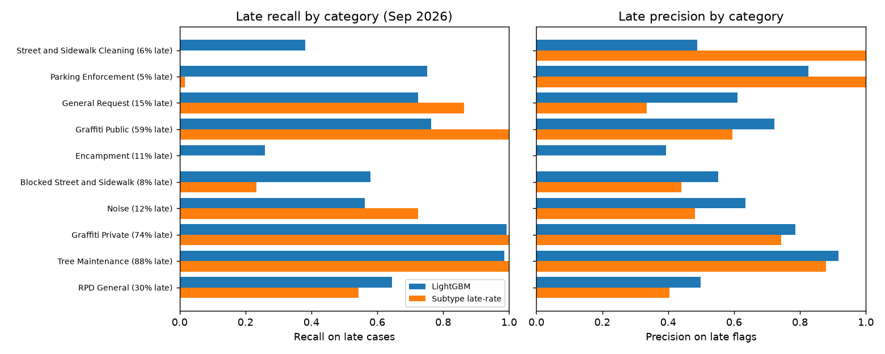
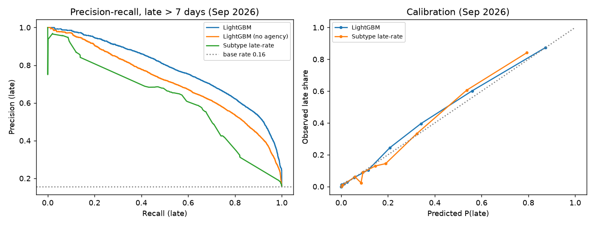
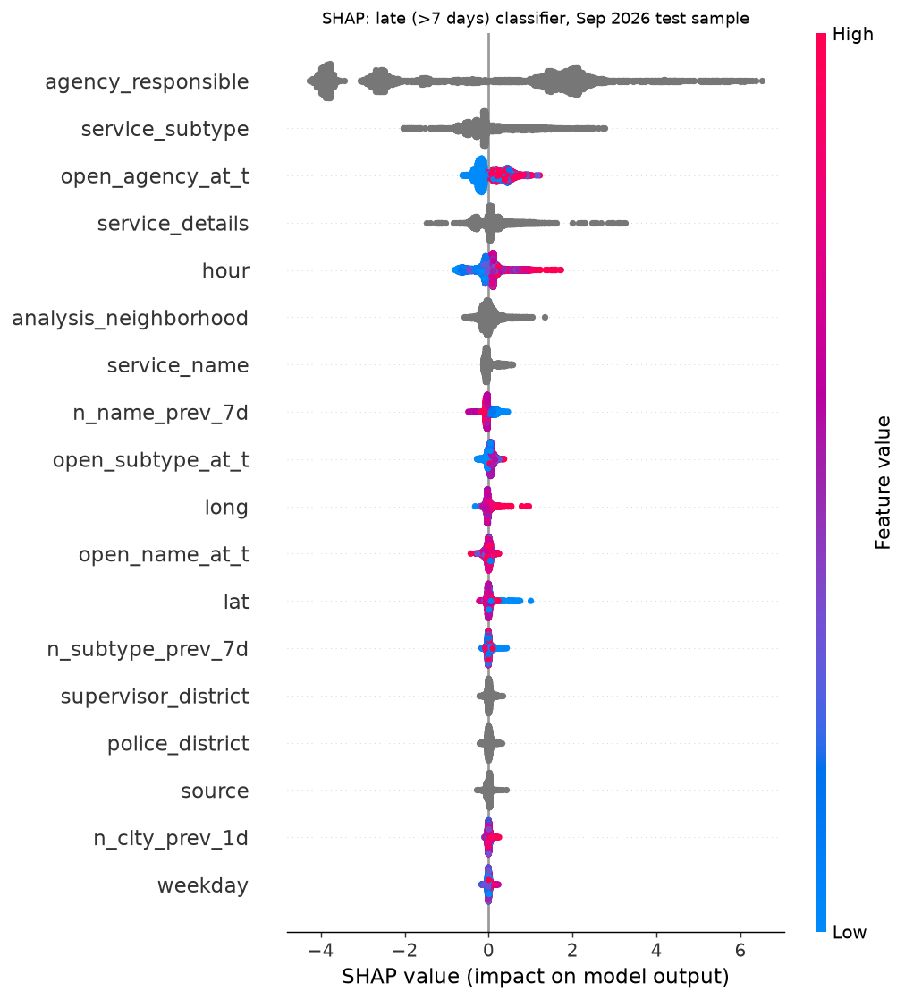
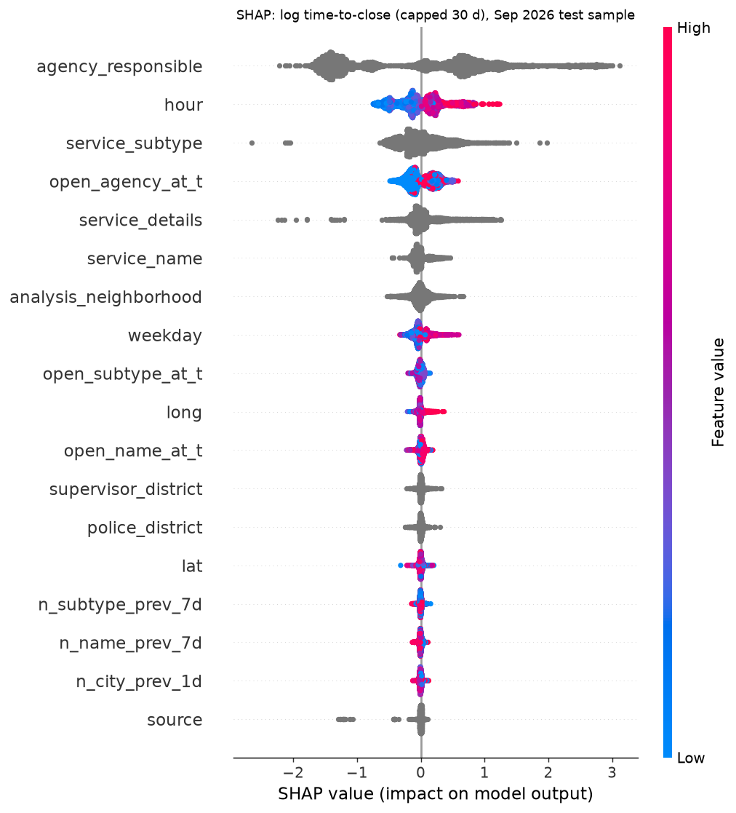
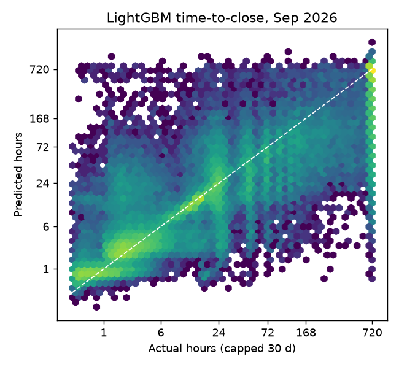

# Resolution-time prediction

**Question:** when a San Francisco 311 request is filed, can we predict how long it will take to close, and flag the ones that will run late?

Code: `src/sf311/resolution.py` (`python -m sf311.resolution train`, a few minutes on CPU). Models: `models/resolution/`. Everything between the AUTO markers at the bottom is regenerated by that command; the prose above it quotes those numbers and must be re-checked after a re-run.

## Headline (test = September 2026, never seen in training or tuning)

| | Baseline | LightGBM | LightGBM without `agency_responsible` |
|---|---|---|---|
| Late (> 7 days) ROC-AUC | 0.847 (per-subtype late rate) | **0.944** | 0.919 |
| Late PR-AUC (base rate 0.156) | 0.577 | **0.776** | 0.709 |
| Late F1 / precision / recall | 0.613 / 0.574 / 0.659 | **0.700 / 0.683 / 0.718** | 0.650 / 0.628 / 0.673 |
| Time-to-close MAE, hours (capped at 30 d) | 79.9 (subtype median); 102.6 (global median) | **62.3** | not run |
| Median absolute error, hours | 8.9; 13.0 | **5.2** | |
| R² on log1p(hours) | 0.36; 0.00 | **0.68** | |
| R² in hours | 0.26; -0.18 | **0.49** | |

- **Versus the prior SF benchmark** (XGBoost R² about 0.26 on 2020 data, split method not stated; docs/prior_work.md #1): our per-subtype median *baseline* already reaches R² 0.26 in hours on a forward split, and LightGBM reaches 0.49 (hours) and 0.68 (log scale). The targets are not identical (theirs is uncapped and covers one pandemic year), so read this as "clearly past that bar", not as a like-for-like comparison. On the closed-only, uncapped target the model gets R² 0.62 (log) and 0.25 (hours): in raw hours the long tail dominates R², which is why the log scale is the main metric.
- **Versus the NYC late-closure model** (F1 0.759 at 72 h; docs/prior_work.md #8): our F1 is 0.700 at 7 days. Different city, threshold and base rate, so the F1 values are not comparable. The point of citing NYC is its failure mode: 0 of 552 late HEAT/HOT WATER cases caught.
- **Per-category check:** of the 22 service categories with at least 30 late cases in September, **none has zero late recall** with LightGBM. The weakest are Encampment (recall 0.26), Muni Service Feedback (0.32) and Streetlights (0.36). The per-subtype baseline, by contrast, reproduces the NYC failure: it catches 0 of 305 late Encampment cases and about 0.1% of late Street and Sidewalk Cleaning cases, because a category that is rarely late on average is never flagged by a category-level rule.
- **Holds up one month further out:** on 1-26 October 2026 (7-day labels settled), ROC-AUC is 0.925 and F1 0.673, versus 0.821 and 0.589 for the baseline.

## How the targets handle censoring

The data snapshot is 2026-11-02 23:59 (last `updated_datetime`). About 8% of September and 13% of October requests were still open then. Training only on closed requests would bias recent months toward fast closures, so both main targets are defined to be fully known for every row scored:

1. **late7d** = not closed within 168 hours. A request still open 7 days after filing is late whatever happens next, so the label is settled for any request at least 7 days older than the snapshot. Still-open requests count as late.
2. **log_hours_cap30** = log1p(min(hours, 720)). Requests still open after 30 days get the 720 h cap. Settled for any request at least 30 days old. Hour metrics are therefore on the capped scale: the tail beyond 30 days is clipped, which also lowers MAE in hours.
3. A secondary **closed-only, uncapped** regression is reported for comparability with prior work. It drops the 7.8% of September requests still open, which are the slowest ones, so it flatters every model.

Excluded from all targets: administrative closures (`is_admin_close`: duplicate, invalid, transferred, "comment noted", not a city issue) and 1,403 rows whose closed date is before the request or after the snapshot (data errors; one closed date is in December 2026).

## Split

Forward in time, aligned with `sf311.dataset` (VAL_START 2026-08-01, TEST_START 2026-09-01):

- **Warm-up, Nov 2025:** used only to fill the backlog counters. Requests filed before Nov 2025 are not downloaded, so open-backlog counts are under-counted in the first weeks. Not trained on.
- **Train:** Dec 2025 to Jul 2026 (491,537 rows). **Validation:** Aug 2026, used for early stopping and to pick the decision threshold (maximum F1). **Test:** Sep 2026 (66,469 rows). **Extra check:** Oct 1-26 2026, classification only, since the 30-day target is not settled for October.
- Known compromise: some August validation labels (30-day horizon) were only known by late September, so a model frozen on 1 September could not yet have used them for early stopping. This affects model selection only, not test labels.

## Features

All are meant to be knowable at filing time (see the agency caveat below).

- Category: `service_name`, `service_subtype`, `service_details` (top 200 values), `agency_responsible`, `source`.
- Place: `supervisor_district`, `analysis_neighborhood`, `police_district`, `lat`, `long`.
- Time: hour, weekday, weekend flag. Month is left out on purpose: with 12 months of data the test month never appears in training, so a month feature could only memorise the training calendar.
- `has_photo`.
- Backlog, from strictly earlier requests and closures only: requests of the same subtype in the previous 1 and 7 days, of the same service_name in the previous 7 days, citywide in the previous day, and the number of **requests still open at filing time** for the same subtype, service_name and agency (filed before t minus closed before t).

## Figures

Recall and precision of the late flag in the ten busiest categories, each model at its own validation-chosen threshold. The baseline's empty bars (Encampment, Street and Sidewalk Cleaning, almost all of Parking Enforcement) are the NYC-style failure; LightGBM catches some late cases in every category.

What SHAP shows: the responsible agency and the request subtype dominate. Next comes the **agency's open backlog at filing time**: a bigger backlog pushes toward late, which is an operational signal that a per-category median cannot capture. Hour of day matters a lot for the regression, consistent with requests filed in the evening waiting for the next shift. Recent-volume counts have smaller, mixed effects.

## Limitations

- **`agency_responsible` may leak.** It is the value in the current snapshot, and a case can be reassigned before it closes. It is also the top feature. Dropping it (and the agency backlog feature) costs about 0.025 ROC-AUC and 0.05 F1, and the model still beats the baseline clearly (0.919 vs 0.847 AUC). Until the intake-time agency is confirmed, treat the no-agency numbers as the conservative estimate. Not yet checked against case update history.
- **One year of data.** Training covers 8 months, so seasonal effects (winter storms, holiday staffing) cannot be learned, and the test is a single month. The October check shows mild decay (AUC 0.944 to 0.925), so monthly retraining is advisable.
- **Capped regression.** Hour errors are on the 30-day-capped scale. Slow categories (Graffiti, Tree Maintenance, which often take weeks) have large hour errors (MAE roughly 100-250 h) and low R² within the category. The model is much better at telling fast from slow than at timing a month-long job to the day.
- **Encampment and Street Cleaning late cases stay hard** (recall 0.26 and 0.38 at the global threshold). Better than the baseline's zero, but a per-category threshold or dedicated model would be needed if those are the cases that matter operationally.
- **Threshold tuned for overall F1.** Per-category precision and recall depend on it; in practice the city would set it from the cost of a missed late case versus a false alarm.
- **Admin closures are inferred from free-text status notes** with a keyword rule (`dataset.py`). Misses and false matches shift the target slightly.
- **Backlog counts are approximate.** Requests filed before Nov 2025 are absent, so long-open older cases are missing from open counts, and closure times come from the snapshot (assumes closed dates are not back-dated).
- **No photo or text features yet.** Whether the photo improves time prediction is still open (docs/prior_work.md, gap 6).

## Results (auto-generated)

<!-- AUTO:START -->
Data snapshot: 2026-11-02 23:59:37. Splits (request date, admin closures removed):

| split | from | to | rows |
|---|---|---|---|
| train | 2025-12-01 | 2026-07-31 | 491,537 |
| val | 2026-08-01 | 2026-08-31 | 65,419 |
| test | 2026-09-01 | 2026-09-30 | 66,469 |
| oct_7d_check | 2026-10-01 | 2026-10-26 | 57,836 |

### Late (> 7 days) classification, test = Sep 2026

| model | n | late_rate | ROC_AUC | PR_AUC | precision | recall | F1 |
|---|---|---|---|---|---|---|---|
| LightGBM | 66,469 | 0.156 | 0.944 | 0.776 | 0.683 | 0.718 | 0.700 |
| LightGBM (no agency) | 66,469 | 0.156 | 0.919 | 0.709 | 0.628 | 0.673 | 0.650 |
| Subtype late-rate | 66,469 | 0.156 | 0.847 | 0.577 | 0.574 | 0.659 | 0.613 |
| Majority (never late) | 66,469 | 0.156 | 0.500 | 0.156 | 0.000 | 0.000 | 0.000 |

Thresholds chosen on Aug 2026 (max F1): LightGBM 0.342, subtype late-rate 0.253.

**Extra check, Oct 1-26 2026** (7-day labels settled; further from training):

| model | n | late_rate | ROC_AUC | PR_AUC | precision | recall | F1 |
|---|---|---|---|---|---|---|---|
| LightGBM | 57,836 | 0.172 | 0.925 | 0.744 | 0.678 | 0.667 | 0.673 |
| LightGBM (no agency) | 57,836 | 0.172 | 0.901 | 0.676 | 0.625 | 0.621 | 0.623 |
| Subtype late-rate | 57,836 | 0.172 | 0.821 | 0.554 | 0.575 | 0.603 | 0.589 |
| Majority (never late) | 57,836 | 0.172 | 0.500 | 0.172 | 0.000 | 0.000 | 0.000 |

### Late classification by category (top 10 by test volume)

| service_name | model | n | late_rate | n_late | ROC_AUC | PR_AUC | precision | recall | F1 |
|---|---|---|---|---|---|---|---|---|---|
| Street and Sidewalk Cleaning | LightGBM | 25,899 | 0.065 | 1,671 | 0.910 | 0.443 | 0.489 | 0.381 | 0.428 |
| Street and Sidewalk Cleaning | Subtype late-rate | 25,899 | 0.065 | 1,671 | 0.501 | 0.066 | 1.000 | 0.001 | 0.002 |
| Parking Enforcement | LightGBM | 16,224 | 0.055 | 892 | 0.984 | 0.828 | 0.825 | 0.752 | 0.787 |
| Parking Enforcement | Subtype late-rate | 16,224 | 0.055 | 892 | 0.777 | 0.135 | 1.000 | 0.016 | 0.031 |
| General Request | LightGBM | 4,512 | 0.154 | 694 | 0.927 | 0.749 | 0.611 | 0.725 | 0.663 |
| General Request | Subtype late-rate | 4,512 | 0.154 | 694 | 0.774 | 0.326 | 0.335 | 0.863 | 0.483 |
| Graffiti Public | LightGBM | 3,567 | 0.594 | 2,120 | 0.742 | 0.813 | 0.723 | 0.763 | 0.742 |
| Graffiti Public | Subtype late-rate | 3,567 | 0.594 | 2,120 | 0.498 | 0.594 | 0.594 | 1.000 | 0.746 |
| Encampment | LightGBM | 2,868 | 0.106 | 305 | 0.757 | 0.333 | 0.393 | 0.259 | 0.312 |
| Encampment | Subtype late-rate | 2,868 | 0.106 | 305 | 0.500 | 0.106 | 0.000 | 0.000 | 0.000 |
| Blocked Street and Sidewalk | LightGBM | 2,081 | 0.085 | 176 | 0.937 | 0.604 | 0.551 | 0.580 | 0.565 |
| Blocked Street and Sidewalk | Subtype late-rate | 2,081 | 0.085 | 176 | 0.603 | 0.166 | 0.441 | 0.233 | 0.305 |
| Noise | LightGBM | 1,437 | 0.116 | 167 | 0.953 | 0.663 | 0.635 | 0.563 | 0.597 |
| Noise | Subtype late-rate | 1,437 | 0.116 | 167 | 0.925 | 0.498 | 0.482 | 0.725 | 0.579 |
| Graffiti Private | LightGBM | 1,370 | 0.743 | 1,018 | 0.722 | 0.872 | 0.785 | 0.992 | 0.877 |
| Graffiti Private | Subtype late-rate | 1,370 | 0.743 | 1,018 | 0.470 | 0.732 | 0.743 | 1.000 | 0.853 |
| Tree Maintenance | LightGBM | 1,221 | 0.879 | 1,073 | 0.870 | 0.975 | 0.918 | 0.985 | 0.950 |
| Tree Maintenance | Subtype late-rate | 1,221 | 0.879 | 1,073 | 0.742 | 0.937 | 0.879 | 1.000 | 0.935 |
| RPD General | LightGBM | 1,049 | 0.298 | 313 | 0.791 | 0.627 | 0.499 | 0.645 | 0.563 |
| RPD General | Subtype late-rate | 1,049 | 0.298 | 313 | 0.619 | 0.373 | 0.405 | 0.543 | 0.464 |

Of 22 service categories with at least 30 late cases in the test month, 0 have zero late recall. Lowest-recall categories:

| service_name | n | n_late | recall | precision | ROC_AUC |
|---|---|---|---|---|---|
| Encampment | 2,868 | 305 | 0.259 | 0.393 | 0.757 |
| Muni Service Feedback | 673 | 102 | 0.324 | 0.388 | 0.790 |
| Streetlights | 325 | 72 | 0.361 | 0.722 | 0.706 |
| Street and Sidewalk Cleaning | 25,899 | 1,671 | 0.381 | 0.489 | 0.910 |
| Muni Employee Feedback | 556 | 177 | 0.525 | 0.460 | 0.682 |
| Noise | 1,437 | 167 | 0.563 | 0.635 | 0.953 |
| Blocked Street and Sidewalk | 2,081 | 176 | 0.580 | 0.551 | 0.937 |
| RPD General | 1,049 | 313 | 0.645 | 0.499 | 0.791 |

### Time-to-close regression, target log1p(min(hours, 720)), test = Sep 2026

| model | n | MAE_h | MedAE_h | MAE_log | R2_log | R2_h |
|---|---|---|---|---|---|---|
| LightGBM | 66,469 | 62.27 | 5.22 | 0.73 | 0.68 | 0.49 |
| Subtype median | 66,469 | 79.88 | 8.86 | 1.15 | 0.36 | 0.26 |
| Global median | 66,469 | 102.55 | 12.99 | 1.61 | -0.00 | -0.18 |

By category (top 10):

| service_name | model | n | MAE_h | MedAE_h | MAE_log | R2_log |
|---|---|---|---|---|---|---|
| Street and Sidewalk Cleaning | LightGBM | 25,899 | 35.04 | 2.13 | 0.72 | 0.55 |
| Street and Sidewalk Cleaning | Subtype median | 25,899 | 43.00 | 8.39 | 1.37 | -0.00 |
| Street and Sidewalk Cleaning | Global median | 25,899 | 43.72 | 12.76 | 1.43 | -0.09 |
| Parking Enforcement | LightGBM | 16,224 | 15.43 | 1.60 | 0.48 | 0.72 |
| Parking Enforcement | Subtype median | 16,224 | 37.94 | 1.56 | 0.73 | 0.19 |
| Parking Enforcement | Global median | 16,224 | 45.95 | 11.92 | 1.37 | -0.22 |
| General Request | LightGBM | 4,512 | 72.74 | 16.64 | 0.92 | 0.53 |
| General Request | Subtype median | 4,512 | 105.37 | 29.21 | 1.39 | 0.02 |
| General Request | Global median | 4,512 | 109.76 | 14.20 | 1.50 | -0.11 |
| Graffiti Public | LightGBM | 3,567 | 253.24 | 170.79 | 1.26 | 0.17 |
| Graffiti Public | Subtype median | 3,567 | 290.56 | 234.12 | 1.43 | -0.06 |
| Graffiti Public | Global median | 3,567 | 355.76 | 290.90 | 2.56 | -1.71 |
| Encampment | LightGBM | 2,868 | 69.05 | 16.24 | 0.97 | 0.31 |
| Encampment | Subtype median | 2,868 | 76.71 | 29.61 | 1.24 | -0.03 |
| Encampment | Global median | 2,868 | 78.50 | 13.96 | 1.35 | -0.14 |
| Blocked Street and Sidewalk | LightGBM | 2,081 | 40.12 | 1.22 | 0.69 | 0.72 |
| Blocked Street and Sidewalk | Subtype median | 2,081 | 52.50 | 1.02 | 1.20 | 0.01 |
| Blocked Street and Sidewalk | Global median | 2,081 | 59.83 | 14.16 | 1.99 | -0.39 |
| Noise | LightGBM | 1,437 | 32.31 | 4.57 | 0.39 | 0.68 |
| Noise | Subtype median | 1,437 | 46.04 | 23.72 | 0.81 | 0.25 |
| Noise | Global median | 1,437 | 60.72 | 17.13 | 1.14 | -0.39 |
| Graffiti Private | LightGBM | 1,370 | 233.47 | 196.37 | 0.86 | 0.23 |
| Graffiti Private | Subtype median | 1,370 | 348.12 | 479.68 | 1.24 | -0.01 |
| Graffiti Private | Global median | 1,370 | 473.40 | 705.42 | 3.00 | -3.88 |
| Tree Maintenance | LightGBM | 1,221 | 116.66 | 50.58 | 0.39 | 0.36 |
| Tree Maintenance | Subtype median | 1,221 | 95.71 | 0.00 | 0.42 | -0.14 |
| Tree Maintenance | Global median | 1,221 | 610.32 | 705.42 | 3.48 | -8.87 |
| RPD General | LightGBM | 1,049 | 110.90 | 48.68 | 0.87 | 0.52 |
| RPD General | Subtype median | 1,049 | 136.41 | 51.67 | 1.20 | 0.10 |
| RPD General | Global median | 1,049 | 158.73 | 57.10 | 1.84 | -0.79 |

### Secondary: closed-only, uncapped log1p(hours) (biased: 92.2% of Sep requests closed by the snapshot)

| model | n | MAE_h | MedAE_h | MAE_log | R2_log | R2_h |
|---|---|---|---|---|---|---|
| LightGBM | 61,291 | 42.18 | 4.30 | 0.74 | 0.62 | 0.25 |
| Subtype median | 61,291 | 48.08 | 7.79 | 1.08 | 0.30 | 0.14 |
| Global median | 61,291 | 54.02 | 11.07 | 1.41 | -0.00 | -0.10 |

### Feature importance (normalised gain)

| feature | gain_clf | gain_reg |
|---|---|---|
| agency_responsible | 0.363 | 0.403 |
| service_subtype | 0.203 | 0.075 |
| service_details | 0.092 | 0.081 |
| service_name | 0.080 | 0.026 |
| open_agency_at_t | 0.075 | 0.080 |
| analysis_neighborhood | 0.035 | 0.049 |
| hour | 0.029 | 0.105 |
| open_name_at_t | 0.018 | 0.021 |
| n_name_prev_7d | 0.015 | 0.016 |
| open_subtype_at_t | 0.014 | 0.019 |
| n_subtype_prev_7d | 0.013 | 0.016 |
| lat | 0.012 | 0.012 |
| long | 0.012 | 0.012 |
| n_city_prev_1d | 0.009 | 0.020 |
| police_district | 0.007 | 0.009 |
| supervisor_district | 0.007 | 0.008 |
| n_subtype_prev_1d | 0.007 | 0.013 |
| weekday | 0.004 | 0.032 |
| source | 0.004 | 0.003 |
| has_photo | 0.000 | 0.001 |
| is_weekend | 0.000 | 0.001 |
<!-- AUTO:END -->
